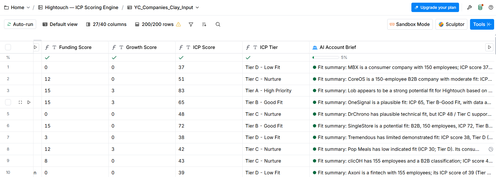

# hightouch-icp-scoring-case-study
# Evidence-Based ICP Scoring & Account Prioritization

**A GTM Engineering portfolio case study using Clay, Excel, and publicly available company data.**

## 1. Project Overview

How can a B2B SaaS company identify and prioritize accounts that are most likely to benefit from its product?

This project explores that question by building an Ideal Customer Profile (ICP) scoring framework for a simulated B2B data activation platform, using Hightouch as the reference company.

The objective was to create an explainable account prioritization system using company characteristics, technology stack, data activation readiness, funding, and growth signals.

Two scoring models were developed, compared, and refined to produce a more transparent and evidence-based approach to account prioritization.

**Important:** This is an independent portfolio simulation based on publicly available information. It does not represent Hightouch's internal ICP model or proprietary customer data.

## 2. Business Problem

Sales and GTM teams often work with large lists of potential accounts. However, not every company has the same level of product fit or buying potential.

Without a structured prioritization framework, sales teams may spend time pursuing accounts that lack:

- A suitable technology infrastructure.
- A relevant data activation use case.
- The right company profile.
- Evidence of growth or expansion.

The challenge was to build a scoring framework that helps identify stronger-fit accounts while distinguishing genuinely weak signals from missing information.

## 3. Tools Used

| Tool | Purpose |
|---|---|
| Clay | Company data enrichment and initial scoring workflow |
| Excel / Google Sheets | Scoring logic, calculations, comparison, and validation |
| GitHub | Project documentation and portfolio presentation |
| Public company sources | Company research and benchmark evidence |

## 4. Project Workflow

1. Defined a simulated ICP hypothesis for a B2B data activation platform.
2. Prepared a company dataset and selected a 10-company sample for detailed scoring.
3. Built a weighted V1 ICP scoring model.
4. Evaluated V1's limitations and redesigned the scoring framework.
5. Built V2 with more granular technology and growth signals.
6. Introduced normalized scoring and data coverage.
7. Compared V1 and V2 outputs.
8. Conducted a qualitative benchmark check against three confirmed Hightouch customers.
9. Documented findings, limitations, and improvement opportunities.

## 5. V1 — Initial ICP Scoring Model

V1 used five weighted dimensions:

| Dimension | Weight |
|---|---:|
| Company Size | 20 |
| Industry Fit | 20 |
| Technology Stack | 30 |
| Funding Stage | 15 |
| Growth Signals | 15 |
| **Total** | **100** |

The model generated a score from 0–100 and assigned an account tier:

- Tier A: 80–100 — High Priority
- Tier B: 60–79 — Good Fit
- Tier C: 40–59 — Nurture
- Tier D: Below 40 — Low Fit

### Limitations identified

- Missing information could be interpreted as a negative signal.
- Technology scoring was not sufficiently granular.
- Growth signals relied heavily on hiring information.
- The model did not explicitly measure data activation readiness.

These limitations informed the development of V2.

## 6. V2 — Evidence-Based ICP Scoring Model

V2 introduced a more detailed scoring framework.

| Dimension | Weight |
|---|---:|
| Data Activation Readiness | 20 |
| Technology Stack | 20 |
| Industry Fit | 15 |
| Company Size | 15 |
| Growth Signals | 15 |
| Funding Stage | 15 |
| **Total** | **100** |

### Technology Stack Breakdown

| Component | Maximum Points |
|---|---:|
| Data Warehouse | 10 |
| Transformation Tools | 5 |
| Destination Tools | 5 |
| **Total** | **20** |

### Growth Signals Breakdown

| Signal | Maximum Points |
|---|---:|
| Hiring Activity | 5 |
| Customer / Revenue / User Growth | 5 |
| Expansion / New Products | 5 |
| **Total** | **15** |

### Normalization and Data Coverage

One important improvement in V2 was its treatment of missing data.

Instead of automatically assigning zero to unknown information, V2 excluded unknown dimensions from the available-points denominator.

**Normalized Score:**

`Raw Score / Maximum Available Points × 100`

**Data Coverage:**

`Maximum Available Points / 100 × 100`

Accounts with less than 70% data coverage were flagged as **Insufficient Data**, rather than being assigned an actionable priority tier.

This distinction helps separate weak-fit accounts from accounts that need further research.

## 7. V1 vs V2 — Results

Ten companies were evaluated using both models.

| Company | V1 Score | V1 Tier | V2 Score | V2 Tier |
|---|---:|---|---:|---|
| MBX | 37 | D | 73.33 | B |
| CoreOS | 51 | C | 57.78 | C |
| Lob | 83 | A | 87.37 | A |
| OneSignal | 65 | B | 87.37 | A |
| DrChrono | 48 | C | 72.50 | B |
| SingleStore | 72 | B | 82.11 | A |
| Tremendous | 38 | D | 52.63 | C |
| Pop Meals | 42 | C | 62.11 | B |
| clicOH | 43 | C | 52.73 | Insufficient Data |
| Axoni | 39 | D | 56.25 | C |

### Key Observations

- Seven accounts received a different outcome or priority classification under V2.
- Two accounts remained in the same tier.
- One account, clicOH, was flagged as Insufficient Data because its coverage was only 55%.
- V2 changed the prioritization of several companies after accounting for activation readiness, more detailed technology signals, and additional growth indicators.

These results demonstrate changes in model behaviour, not proof that V2 predicts customer conversion more accurately.

**Explore the analysis:** [V1 vs V2 Comparison](analysis/V1_vs_V2_Comparison.xlsx)

## 8. Customer Benchmark Validation

To conduct an initial qualitative sanity check, three publicly documented Hightouch customers were reviewed.

| Customer | Confirmed Customer | Key Documented Use Case |
|---|---|---|
| Ramp | Yes | Personalized sales prospecting and outbound automation |
| Retool | Yes | Product-usage-based personalized sales outreach |
| Calendly | Yes | Customer segmentation, personalization, and marketing activation |

The review considered publicly documented company characteristics, data infrastructure, technology signals, and activation use cases.

**Result: 3 out of 3 benchmark customers were recognized as qualitative fits.**

Recognition Rate: 100%

### Important Validation Limitation

This is a small, positive-customer-only benchmark.

No non-customer comparison group was included. Therefore, the result does not establish predictive accuracy, precision, recall, or the ability to distinguish customers from non-customers.

**Explore the validation:** [Customer Validation](analysis/Customer_Validation.xlsx)

## 9. Key Findings

1. Data activation readiness provides useful context beyond basic company characteristics.
2. More granular technology signals improve the explainability of account scores.
3. Missing data should not automatically be treated as evidence of poor fit.
4. Publicly documented customer use cases can provide useful qualitative benchmark evidence.
5. A scoring model needs continuous validation and refinement as new evidence becomes available.

## 10. Model Limitations & Future Improvements

| Limitation | Proposed Improvement |
|---|---|
| Small sample of 10 scored companies | Test on a larger, representative dataset |
| Predefined technology list may miss equivalent tools | Expand technology mappings and alternative stack architectures |
| Company information may be outdated | Use fresher sources and record source dates |
| Public growth and activation evidence may be incomplete | Add evidence links, timestamps, and confidence ratings |
| Only positive customer benchmarks were tested | Include non-customers and evaluate precision, recall, and ranking performance |

**Explore the findings:** [Final Model Findings](analysis/Final_Model_Findings.xlsx)

## 11. Final Conclusion

This project demonstrates how a structured ICP scoring framework can make account prioritization more transparent, explainable, and consistent.

The transition from V1 to V2 introduced more detailed technology and growth signals, normalized scoring, and explicit data coverage.

V2 was selected as the final portfolio model because it handles missing information more thoughtfully and makes its scoring decisions easier to interpret.

However, the model remains a working hypothesis and requires larger-scale testing before it can be considered production-ready.

## 12. Project Files & Repository Structure

### Scoring Models

- [V1 ICP Scoring Model](scoring/ICP_Scoring_V1_Test_Results.xlsx)
- [V2 ICP Scoring Model](scoring/ICP_Scoring_V2_Test.xlsx)

### Analysis & Validation

- [V1 vs V2 Comparison](analysis/V1_vs_V2_Comparison.xlsx)
- [Customer Validation](analysis/Customer_Validation.xlsx)
- [Final Model Findings](analysis/Final_Model_Findings.xlsx)

### Dataset

- [Sample Companies Dataset — CSV](data/sample_companies.csv)


## Repository Structure

```text
hightouch-icp-scoring-case-study/
│
├── README.md
├── data/
│   └── sample_companies.csv
│
├── scoring/
│   ├── ICP_Scoring_V1_Test_Results.xlsx
│   └── ICP_Scoring_V2_Test.xlsx
│
├── analysis/
│   ├── V1_vs_V2_Comparison.xlsx
│   ├── Customer_Validation.xlsx
│   └── Final_Model_Findings.xlsx
│
└── images/
    ├── ICP Scoring.png
    ├── Website & technology stack.png
    ├── Funding Score.png
    └── AI_briefing.png
```


## Project Disclaimer

This project is an independent educational and portfolio exercise. Hightouch was selected as a reference company for developing a simulated ICP hypothesis. The scoring rules, weights, analysis, and conclusions are independently created and are not affiliated with or endorsed by Hightouch.

## Project Screenshots

### 1. ICP Scoring


### 2. Website & Technology Stack


### 3. Funding Score


### 4. AI Account Briefing

